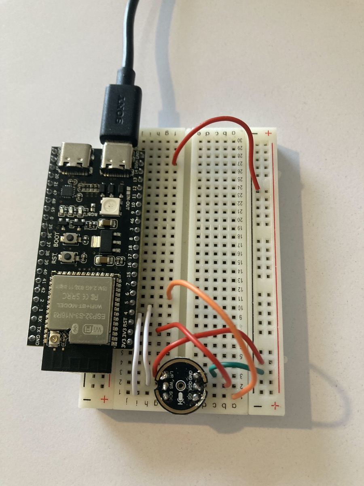

# ESP32-S3 Keyword Spotting

## Project Description

This project demonstrates keyword spotting on the ESP32-S3-DevKit using the TinyKW library and the INMP441 microphone.

## Hardware setup



INMP441 > ESP32-S3:
- VDD > 3V3
- GND > GND
- SCK > GPIO 4
- WS > GPIO 5
- SD > GPIO 6
- L/R > GND

## Software setup

```
idf.py set-target esp32s3
idf.py build flash monitor
```

Tested on ESP-IDF version 6.1.1.

## Memory usage

TinyKW uses about 15 KB of static RAM with no heap allocation and about 300 KB of Flash.

## CPU usage

| Setting                                                    | Clock Frequency | CPU usage (one core)    |
| --------                                                   | -------         | -------                 |
| Flash (QIO, 80 Mhz)<sup>1</sup>                            | 160 MHz         | **63 %**                | 
| Flash (QIO, 80 Mhz)                                        |   240 MHz       | **46 %**                |
| Read-only data in PSRAM (Octal mode, 80 Mhz)<sup>2</sup>   | 240 MHz         | **40 %**                |

Measured on ESP32-S3-N16R8.

<sup>1</sup>: `idf.py menuconfig` > `Serial Flasher Config` > `Flash SPI mode (QIO)` and `Flash SPI speed (80 MHz)`

<sup>2</sup>: `idf.py menuconfig` > `Component Config` > `ESP PSRAM` > Enable `Support for external, SPI-connected RAM`, 
then `SPI RAM config` > `Mode (Octal Mode PSRAM)`, `Set RAM clock speed (80 MHz)` and Enable `Move Read-Only Data in Flash to PSRAM`.

## Using another language

Path to the library can be modified in `components/tinykw/CMakeLists.txt` to use a specific language. For example, to use Italian language:
`add_prebuilt_library(tinykw_prebuilt "lib/it/libtinykw.a")`. Available languages are `en`, `fr`, `de`, `es`, `it`, `pt`, `zh` and `ja`.

## Using other keywords

Keywords encodings can be retrieved from the [TinyKW Console](https://voyelle.io/tinykw/encoder). 
Then you can add them to or replace existing ones by modifying `main/keywords_encodings.h` and `main/keywords_encodings.c`.
Please note that keywords encodings must match the language of the TinyKW library.

## License

The code in this repository is licensed under MIT. TinyKW is distributed as a prebuilt library under the Apache 2.0 licence.
